# Control Readiness Index (CRI): Measurement-Driven Readiness for Safe Controller Activation

**A measurement-driven Control Readiness Index (CRI) that decides, online and from input-output
data alone, whether an adaptive, learning-based, or optimization-driven controller should
currently be trusted with a plant -- demonstrated on a converter-dominated hybrid AC/DC
microgrid supervising an online-feedback-optimization (OFO) VSC setpoint coordinator, and
released as a plant-agnostic package ready for any team's own controller, plant, or hardware.**


This repository contains the complete simulation framework, controller and CRI implementation,
benchmark and validation modules, recorded results, and reproducible notebooks.

The readiness layer itself is plant-agnostic: it needs only input-output measurements, operational
limits, and a fallback controller, so it can supervise adaptive, learning-based, or
optimization-driven controllers in other industrial cyber-physical systems, such as power
converters, process plants, or motion systems. The hybrid AC/DC microgrid is the reference case
study used to validate it; see
[Extending the Framework](#extending-the-framework-bring-your-own-controller-plant-or-hardware)
for applying it to a new controller, plant, or hardware target.

The framework ships in two commissioning modes of the same CRI architecture --
**Engineering-Configured CRI (EC-CRI)**, a fixed, engineering-tuned configuration, and
**Data-Calibrated CRI (DC-CRI)**, a risk-constrained, data-driven calibration of the same five
weights and three decision thresholds, validated under an 8-fold leave-one-scenario-out (LOSO)
protocol. DC-CRI is an alternative commissioning path through the same `cri_microgrid` package,
selected only by passing a different `CRIParams` -- the online supervisor is identical.

The release also includes a comparative benchmark against **runtime-assurance (Simplex RTA)** and
**control-barrier-function (CBF)** supervision, and a **Measurement Validity Gate** with
fault-injection and recovery tests.

**Version:** v1.0.0 &nbsp;|&nbsp; **Last updated:** 2026-11-22

---

## Table of Contents

1. [Overview](#overview)
2. [Problem Formulation](#problem-formulation)
3. [The CRI Framework at a Glance](#the-cri-framework-at-a-glance)
4. [Architecture](#architecture)
5. [Case Study](#case-study)
6. [Key Results (EC-CRI)](#key-results-ec-cri)
7. [Data-Calibrated CRI (DC-CRI): LOSO Calibration and Risk-Aware Deployment](#data-calibrated-cri-dc-cri-loso-calibration-and-risk-aware-deployment)
8. [Comparison with Runtime Assurance and Control Barrier Functions](#comparison-with-runtime-assurance-and-control-barrier-functions)
9. [Measurement Validity Gate](#measurement-validity-gate)
10. [EC-CRI Weight Sensitivity](#ec-cri-weight-sensitivity)
11. [Repository Structure](#repository-structure)
12. [Installation](#installation)
13. [Quick Start](#quick-start)
14. [Notebooks Guide](#notebooks-guide)
15. [Reproducing the Results](#reproducing-the-results)
16. [CRI Design Parameters](#cri-design-parameters)
17. [Extending the Framework: Bring Your Own Controller, Plant, or Hardware](#extending-the-framework-bring-your-own-controller-plant-or-hardware)
18. [Supplementary Material](#supplementary-material)
19. [Scope and Limitations](#scope-and-limitations)
20. [Citation and Archiving](#citation-and-archiving)
21. [License](#license)
22. [Acknowledgments](#acknowledgments)
23. [Contact](#contact)

---

## Overview

Adaptive, learning-based, and optimization-driven controllers are attractive for uncertain,
time-varying systems, but most of the literature focuses on *how to control well once active* and
leaves an equally important question implicit: **is the plant currently ready for this controller
to be safely activated at all?**

The **Control Readiness Index (CRI)** answers this from online measurements alone, without a
plant model, a Jacobian, or knowledge of the true topology. It combines five normalized
indicators --

| Indicator | Symbol | Answers |
|---|---|---|
| Responsiveness | RI | Can the controller measurably influence the system? |
| Coupling | CI | Will one action unintentionally disturb many variables? |
| Safety margin | SMI | Is there enough margin for adaptation or probing? |
| Adaptability | AI | Is the plant changing faster than the controller can adapt? |
| Noise confidence | NCI | Can the measured sensitivity be trusted? |

-- into a bounded scalar `CRI ∈ [0,1]`, filtered dynamically, and mapped into
**Activate / Monitor / Delay / Reject** decisions that gate both the controller's activation
status `s_k` and an adaptation-scaling factor `κ_k`.

Every simulation in this repository is built to answer one question directly:

> **Does the CRI correctly recognize when an advanced controller should and should not be
> trusted, and does that decision improve safety without unnecessarily preventing useful
> control?**

The same OFO candidate controller, the same plant, and the same disturbance realization are run
under several supervisory strategies -- **Direct** activation (`s_k=1` always), a conventional
**Hard-limit / Threshold** rule (`s_k=1` iff every instantaneous hard limit is currently
satisfied), **EC-CRI**, **DC-CRI**, and, in the benchmark, **Simplex RTA** and a **CBF safety
filter** -- and only the supervisory layer differs, giving a fair, paired comparison in every
scenario.

## Problem Formulation

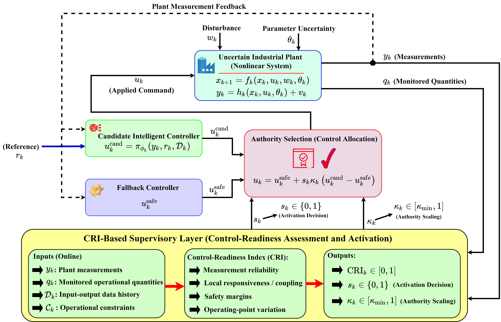

*Problem formulation and supervisory control architecture for intelligent-controller activation.
An uncertain plant $`x_{k+1}=f_k(x_k,u_k,w_k,\theta_k)`$, $`y_k=h_k(x_k,u_k,\theta_k)+v_k`$ is driven
either by a candidate intelligent controller $`u_k^{\mathrm{cand}}`$ or by a conservative fallback
controller $`u_k^{\mathrm{safe}}`$. The CRI-based supervisory layer uses only measurements,
monitored quantities, recent input-output data, and operational constraints to produce
$`\mathrm{CRI}_k\in[0,1]`$, the activation decision $`s_k\in\{0,1\}`$, and the authority scaling
$`\kappa_k\in[\kappa_{\min},1]`$, which allocate control authority through
$`u_k=u_k^{\mathrm{safe}}+s_k\kappa_k(u_k^{\mathrm{cand}}-u_k^{\mathrm{safe}})`$.*

The **fallback controller** (here a droop/PI VSC controller, `controllers.FallbackDroopController`)
receives authority whenever $`s_k=0`$. The framework assumes -- but does not itself guarantee --
that the fallback keeps the plant admissible; the results below show explicitly where this
assumption does not hold in the stress scenarios.

## The CRI Framework at a Glance

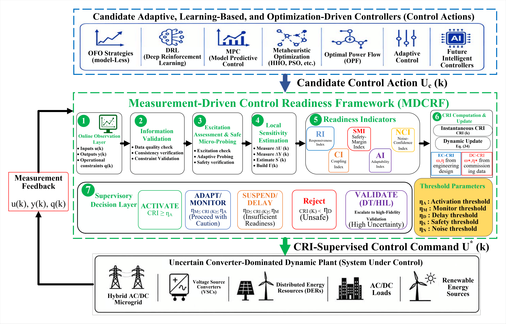

*Proposed measurement-driven control readiness framework: online observation, information
validation, excitation assessment with safe micro-probing, local sensitivity estimation, the five
readiness indicators, CRI computation with dynamic update (EC-CRI or DC-CRI parameters), and the
supervisory decision layer (Activate / Monitor / Delay / Reject, with digital-twin/HIL escalation
under high uncertainty).*

Every step is implemented as its own small, pure function in `cri_microgrid`, independently
testable:

| Step | Formula | Implementation |
|---|---|---|
| Normalized increments | $`\Delta\widetilde u_k=D_u^{-1}\Delta u_k,\ \Delta\widetilde y_k=D_y^{-1}\Delta y_k`$ | `config.DEFAULT_D_u`, `DEFAULT_D_y` |
| Safe-probing amplitude | $`\bar\delta_k=\bar\delta_{\max}\,\mathrm{SMI}_k`$ | `probing.scale_probe_with_smi` |
| Weighted regularized sensitivity | $`\hat S_k=\Delta\widetilde Y_kW_k\Delta\widetilde U_k^T\left(\Delta\widetilde U_kW_k\Delta\widetilde U_k^T+\lambda_sI\right)^{-1}`$ | `sensitivity.estimate_sensitivity` |
| Responsiveness | $`\rho_k=\tfrac{1}{n_u}\lVert\hat S_k\rVert_F^2,\ \mathrm{RI}_k=1-e^{-\rho_k/r_0}`$ | `sensitivity.SensitivityResult.rho`, `cri.compute_RI` |
| Coupling | $`c_k`$ (column-normalized off-diagonal ratio), $`\mathrm{CI}_k=1-c_k`$ | `sensitivity.coupling_raw`, `cri.compute_CI` |
| Safety margin | $`\psi_{\ell,k}=\dfrac{-g_\ell(q_k)}{m_\ell^{\mathrm{safe}}+\varepsilon_0}`$, $`\mathrm{SMI}_k=\min_\ell\mathrm{sat}_{[0,1]}(\psi_{\ell,k})`$ | `cri.microgrid_margins`, `cri.compute_SMI` |
| Adaptability | $`\mathrm{AI}_k=\exp(-a_k/a_0)`$ | `cri.compute_AI` |
| Noise confidence | $`\mathrm{NCI}_k=\exp(-\hat\sigma_{y,k}^2/\sigma_{y,0}^2)\exp(-\varepsilon_{s,k}^2/\varepsilon_{0,s}^2)`$ | `cri.compute_NCI` |
| CRI combination | $`\widehat{\mathrm{CRI}}_k=\boldsymbol\omega^T\Gamma_k`$, $`\boldsymbol\omega\succeq0`$, $`\mathbf 1^T\boldsymbol\omega=1`$ | `cri.compute_instantaneous_cri` |
| Dynamic filter | $`\mathrm{CRI}_k=(1-\beta_k)\mathrm{CRI}_{k-1}+\beta_k\widehat{\mathrm{CRI}}_k`$ | `cri.update_dynamic_cri`, `cri.compute_beta` |
| Classification | Activate / Monitor / Delay / Reject via $`\eta_A,\eta_M,\eta_D`$ | `cri.classify_readiness` |
| Activation & adaptation scaling | $`s_k`$, $`\kappa_k=\mathrm{sat}_{[\kappa_{\min},1]}\!\left(\frac{\mathrm{CRI}_k-\eta_D}{\eta_A-\eta_D}\right)`$ | `cri.compute_activation`, `cri.compute_kappa` |
| Shadow adaptation | $`\phi_{k+1}=\phi_k+\kappa_k\Delta\phi_k^{\mathrm{nom}}`$, applied every step (also while $`s_k=0`$) so the candidate stays warmed up | `OFOVSCController.shadow_update` |
| Authority blending | $`u_k=u_k^{\mathrm{safe}}+s_k\kappa_k(u_k^{\mathrm{cand}}-u_k^{\mathrm{safe}})`$ | `controllers.blend_command` |
| Digital-twin escalation | $`d_k^{\mathrm{DT}}`$ (low SMI or NCI) | `cri.compute_dt_flag` |
| Computational complexity | $`\mathcal{O}(n_yn_uN+n_u^2N+n_u^3)`$ per update | `sensitivity.estimate_sensitivity` (dominant cost), benchmarked in `timing.py` |

## Architecture

The CRI module never sees the plant model. It receives only the applied command, the (possibly
noisy) measured output, the known operational limits, and measurement-quality information --
enforced in code, not just claimed in prose: `sim.py` is the only place `hidden_truth` (true
topology, true actuator effectiveness, true noise level) is available, and it is passed *only* to
`validation.py`, which builds the simulation-only ground-truth label `z_k^unsafe` used for
**evaluation after the fact**. `cri.py` and `controllers.py` never receive it.

```
measurement-driven readiness loop (per sample k)
  plant.py            -->  y_k  (measured), hidden_truth (validation-only)
  [mvg.py]            -->  optional Measurement Validity Gate on the delivered sample
  probing.py          -->  safe micro-probe, amplitude scaled by SMI_{k-1}
  sensitivity.py      -->  S_hat_k  (regularized local sensitivity, from (u,y) windows only)
  cri.py              -->  RI, CI, SMI, AI, NCI  ->  CRI_k  ->  class, s_k, kappa_k, DT flag
  controllers.py      -->  u_safe (fallback droop), u_candidate (OFO), blended command
```

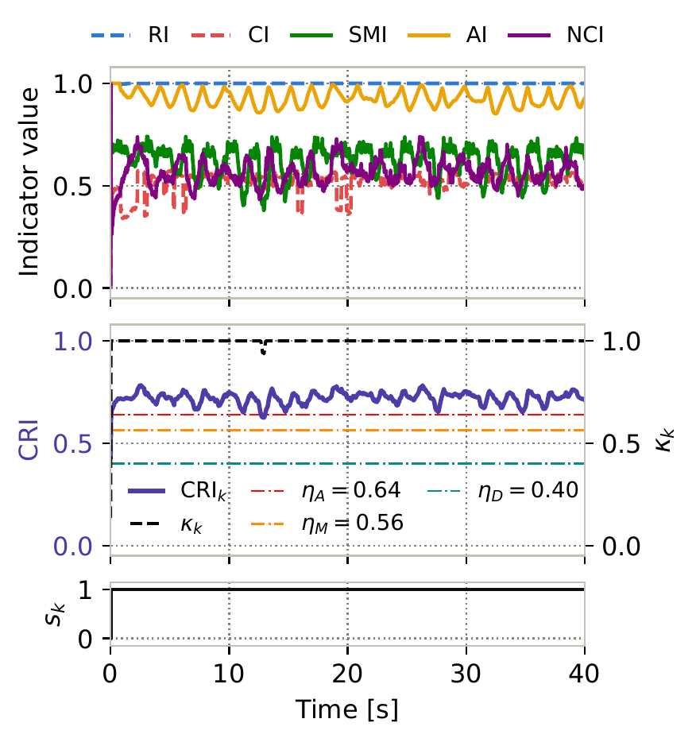

*CRI readiness dashboard for the nominal case (S1): operating stress, the five readiness
indicators, the combined CRI with its Activate/Monitor/Delay/Reject decision regions, and the
resulting activation signal.*

## Case Study

The framework is demonstrated on a converter-dominated hybrid AC/DC microgrid: two coordinated
VSCs on a shared DC link, each feeding an AC bus, with a CRI-supervised OFO setpoint coordinator
as the candidate controller and a conventional droop/PI controller as the fallback.

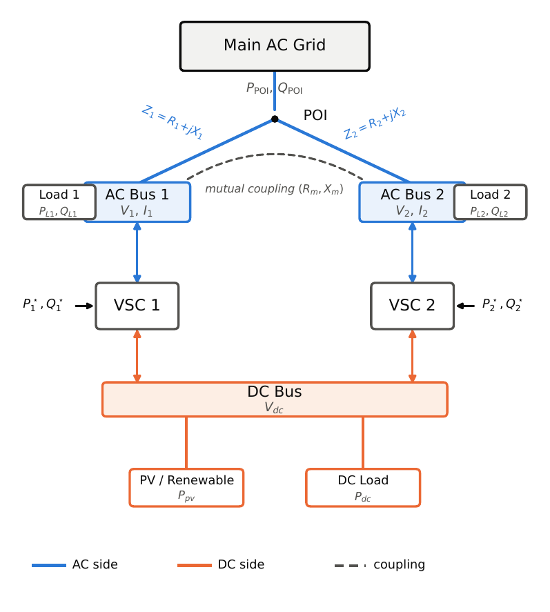

*The two-VSC hybrid AC/DC microgrid topology used throughout every scenario.*

Eight stress scenarios are used throughout: S1 nominal, S2 constraint-limited loading, S3 weak
actuator authority, S4 coupling change, S5 fast drift, S6 measurement noise, S7 topology change
(VSC2 outage), and S8 a combined severe case.

## Key Results (EC-CRI)

All numbers below are reproducible from `results/*.csv` via the corresponding notebook. They use
the instantaneous, mechanism-based ground-truth label $`z_k^{\mathrm{unsafe}}`$ (EC protocol).

| Scenario | Headline finding |
|---|---|
| **S1 -- Nominal** | RI≈1, AI>0.85, with CI/SMI/NCI at a healthy 0.5-0.75; mean CRI=0.72 stays comfortably above $`\eta_A=0.64`$, giving continuous activation (99.85% availability) with **zero false activations** |
| **S2 -- Constraint-limited** | As load ramps ($`t=6`$-$`34`$ s) toward the voltage/current limits, SMI collapses from 0.74 to 0.06, pulling CRI from 0.78 to 0.43 -- the supervisor spends 47.9% of the run in Monitor, briefly touches Delay, and never Rejects |
| **Safe-probing verification (S2)** | Whenever probing occurs (1228 of 2001 steps), the probe amplitude tracks SMI with correlation **>0.9999**, and every probed sample satisfies the safety bound with **zero violations** |
| **S3 -- Weak actuator authority** | Under a symmetric loss of actuator authority, RI falls from 0.97 to 0.81 (min 0.66); CRI-supervised activation cuts false activations to **9**, vs. 1411 (Direct) and 186 (Threshold) |
| **S5 -- Fast drift** | Mean AI falls monotonically with drift speed: 0.95 (normal) -> 0.84 (fast) -> 0.79 (very fast); false activations: **499** (CRI) vs. 1570 (Direct) and 1131 (Threshold) |
| **S6 -- Noise confidence** | NCI collapses from 0.57 to under $`10^{-3}`$ by 1% measurement noise while SMI stays in a healthy 0.46-0.68 band and RI≡1.0 -- each indicator responds to its own targeted failure mode |
| **S7 -- Topology change (full VSC2 outage)** | Sensitivity matrix reshapes immediately (largest element change 1.86); RI collapses 1.00->0.00 and CI 0.52->0.00; CRI detects and rejects within **60 ms**. A genuine hazard: direct activation is falsely active for the entire post-event window (**1101** false activations) vs. just 2 (Threshold) and 5 (CRI) |
| **S8 -- Combined severe case** | CRI drops activation to 0 within **0.38 s** and never returns (vs. 16.70 s Threshold, 50.02 s Direct); false activations cut from 2501 (Direct) and 835 (Threshold) to just **19** (CRI) |
| **All 8 scenarios, aggregate** | Mean false-activation count: **66.5 (CRI)** vs. 822.9 (Direct) vs. 269.3 (Threshold) -- a **12.4x** reduction vs. Direct and **4.0x** vs. Threshold; mean unsafe-active fraction: **5.8% (CRI)** vs. 50.0% (Direct) vs. 16.8% (Threshold) |

<p align="center">
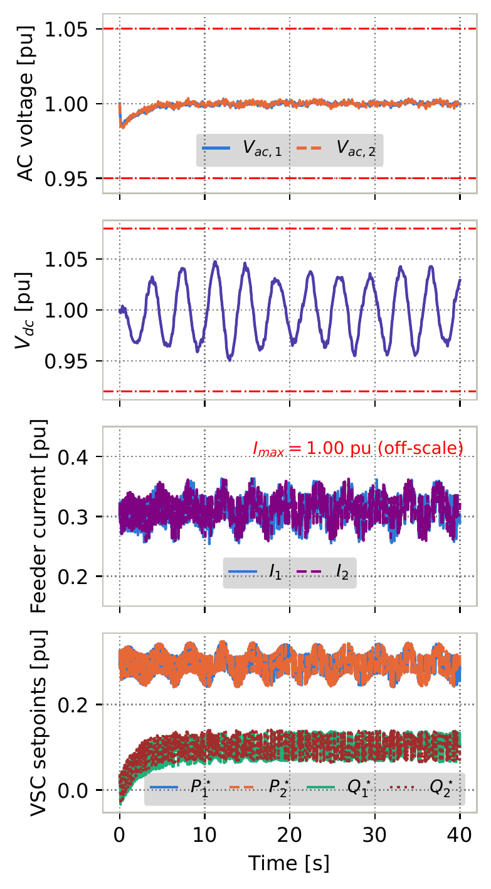
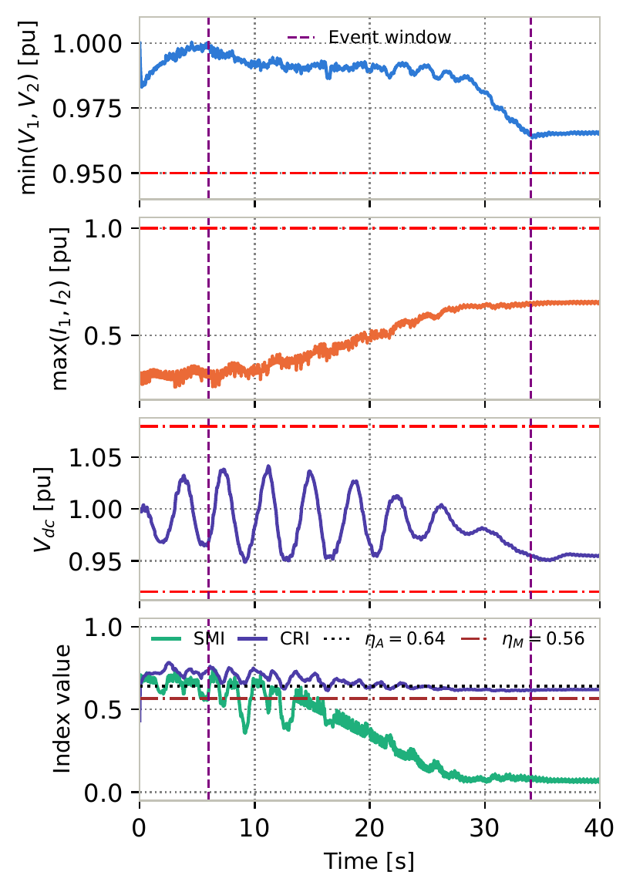
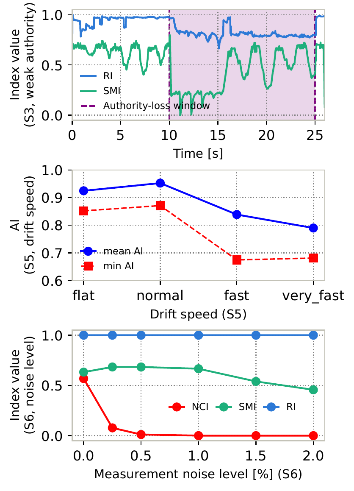
</p>
<p align="center">
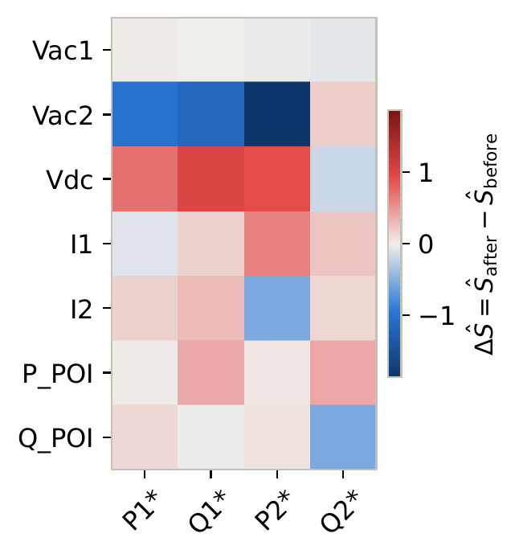
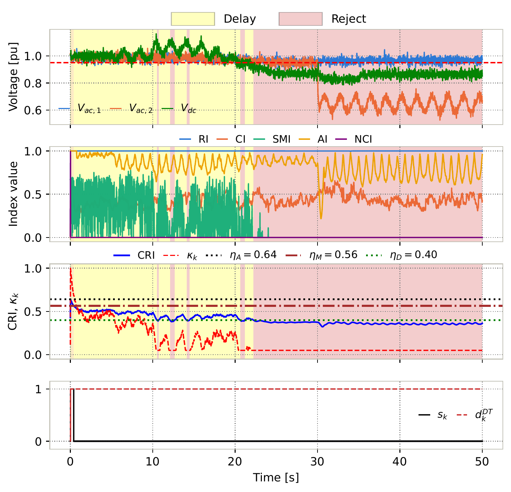
</p>

**Comparison of controller-activation strategies (S8, combined severe case)**
(source: `results/results_strategy_comparison.csv`):

| Method | $`E_V`$ | $`E_I`$ | $`N_{FA}`$ | $`T_{on}`$ [s] |
|---|---|---|---|---|
| Direct activation | 0.1559 | 0.0000 | 2501 | 50.02 |
| Threshold-based activation | 0.1663 | 0.0000 | 835 | 16.70 |
| **CRI-based activation** | 0.1688 | 0.0000 | **19** | **0.38** |

Voltage-regulation quality ($`E_V`$) is comparable across all three strategies, and no strategy ever
reaches the current limit ($`E_I=0`$) in this scenario -- the safety benefit comes from *when*
the candidate controller is allowed to act, at essentially no cost to control quality when it does.
Across all eight scenarios, every strategy correctly reaches zero false activations in the four
scenarios with no genuine hazard (S1, S2, S4, S6), confirming the CRI does not unnecessarily
withhold activation when conditions are safe.

## Data-Calibrated CRI (DC-CRI): LOSO Calibration and Risk-Aware Deployment

EC-CRI's five weights $`\omega_i`$ and three decision thresholds $`\eta_A,\eta_M,\eta_D`$ are
engineering defaults. **DC-CRI** calibrates the same quantities directly from closed-loop data,
under an explicit activation-risk tolerance $`\epsilon_{\mathrm{risk}}`$ and a finite verification
horizon $`T_H`$, then evaluates the result on genuinely unseen operating conditions -- module
`cri_microgrid/dc_calibration.py`, notebooks `13_dc_cri_loso.ipynb` and
`14_dc_cri_sensitivity.ipynb`; `cri.py`, `sim.py`, and every EC-CRI notebook are unchanged.

**Calibration in one paragraph.** For a finite horizon $`H`$ (samples), a hard-limit hazard label
$`z_k^{(H)}=1`$ iff any of the next $`H`$ samples violates a voltage/current/DC-link limit. Weights
$`\boldsymbol\omega`$ are fit on the probability simplex by a small class-normalized least-squares
QP so that $`\mathrm{CRI}_k`$ tracks $`1`$ on safe samples and is penalized on hazardous ones
($`\lambda_H`$-weighted). The activation threshold is then chosen by the **risk-constrained
threshold rule**

```math
\eta_A^\star=\arg\max_{\eta\in[0,1]}\widehat{\mathcal A}(\eta)\quad\text{s.t.}\quad\widehat{\mathcal R}_{\mathrm{act}}(\eta)\le\epsilon_{\mathrm{risk}},
```

i.e. **controller availability is maximized subject to the empirical activation risk staying at or
below $`\epsilon_{\mathrm{risk}}`$** -- the risk tolerance is a hard constraint, not a soft
preference. The Monitor/Delay thresholds follow as relative margins below the activation threshold,
$`\eta_M=\eta_A^\star-\Delta_M`$ and $`\eta_D=\eta_A^\star-\Delta_D`$, with $`0\lt\Delta_M\lt\Delta_D`$ chosen on the
calibration data to minimize supervisory switching. All of this is an offline
post-processing step on logged $`(\Gamma_k, z_k^{(H)})`$ data -- the online `CRISupervisor` is
unchanged; DC-CRI is only a different `CRIParams`.

**Validation protocol: 8-fold leave-one-scenario-out (LOSO).** For each scenario $`S_j`$ in turn,
DC-CRI is calibrated **only** on the data of the other seven,
$`\mathcal D_{\mathrm{cal}}^{(-j)}=\bigcup_{i\neq j}\mathcal D(S_i)`$, then the calibrated
parameters are frozen and evaluated with a fresh closed-loop simulation on the held-out scenario,
$`\mathcal D_{\mathrm{test}}^{(j)}=\mathcal D(S_j)`$ -- the calibration procedure never sees the
scenario it is scored on. This is run at the principal settings ($`\epsilon_{\mathrm{risk}}=0.01`$,
$`T_H=0.5`$ s, $`\lambda_H=2.0`$) as well as across four risk tolerances and four horizons, to
characterize the resulting engineering trade-offs rather than report one number in isolation.

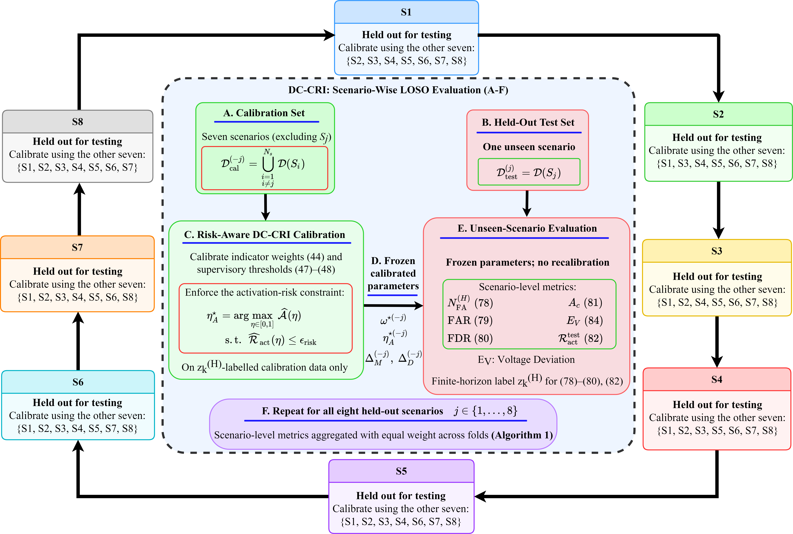

*Scenario-wise LOSO calibration and unseen-scenario evaluation of DC-CRI. In each of the eight
folds, seven scenarios form the calibration set (A), the remaining scenario is the held-out test
set (B); weights and thresholds are calibrated under the activation-risk constraint on
$`z_k^{(H)}`$-labelled calibration data only (C), frozen (D), and evaluated on the unseen scenario
without recalibration using $`N_{\mathrm{FA}}^{(H)}`$, FAR, FDR, $`A_c`$, $`E_V`$ and
$`\mathcal R_{\mathrm{act}}^{\mathrm{test}}`$ (E). The procedure repeats for all eight held-out
scenarios, and scenario-level metrics are aggregated with equal weight across folds (F).*

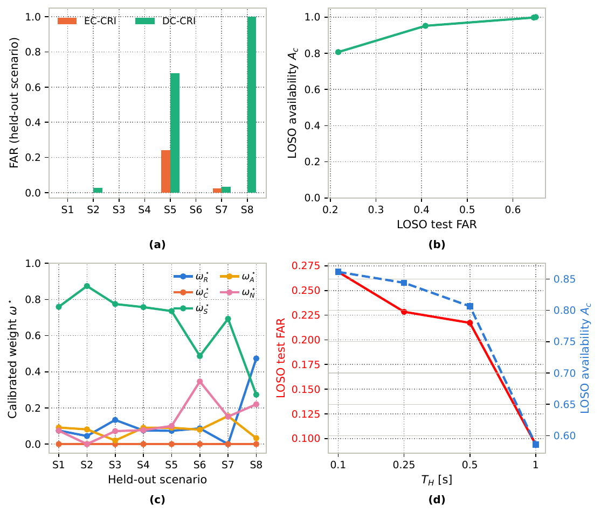

*(a) Out-of-scenario false-activation rate (FAR) by held-out scenario, EC-CRI vs. DC-CRI. (b)
LOSO-aggregate availability vs. FAR across four tested risk tolerances $`\epsilon_{\mathrm{risk}}`$.
(c) The five calibrated weights across all eight LOSO folds -- the coupling weight $`\omega_C^\star`$
calibrates to exactly zero in every fold; the safety-margin weight $`\omega_S^\star`$ dominates in
seven of eight. (d) LOSO-aggregate FAR and availability across four tested verification horizons
$`T_H`$.*

**Headline LOSO result** (all 8 folds, $`\epsilon_{\mathrm{risk}}=0.01`$, $`T_H=0.5`$ s; each held-out
scenario averaged over its own evaluation seeds first, then the 8 scenario-level values averaged
with equal weight -- source: `results/results_dc_cri_loso_aggregate.csv`):

| Method | $`N_{FA}^{(H)}`$ | FAR | FDR | $`A_c`$ | $`E_V`$ |
|---|---|---|---|---|---|
| Direct activation | 794.9 | 0.500 | 0.000 | 1.000 | 0.043 |
| Hard-limit supervisor | 222.1 | 0.142 | 0.022 | 0.756 | 0.044 |
| EC-CRI | 6.1 | 0.033 | 0.247 | 0.683 | 0.046 |
| **DC-CRI** | 374.3 | 0.217 | **0.054** | **0.806** | 0.048 |

Here $`N_{FA}^{(H)}`$ is the false-activation count, FAR the false-activation rate and FDR the
false-deactivation rate (all with respect to $`z_k^{(H)}`$), $`A_c`$ the controller availability, and
$`E_V`$ the voltage-deviation metric.

At this risk tolerance, DC-CRI is less over-conservative than EC-CRI (FDR $`0.05`$ vs. $`0.25`$ -- EC-CRI
withholds activation during genuinely safe conditions roughly a quarter of the time) and reaches
$`12`$ percentage points higher controller availability ($`0.806`$ vs. $`0.683`$), while staying well
below direct activation's false-activation rate ($`0.217`$ vs. $`0.500`$). Calibration is feasible in
all **8/8** LOSO folds, and the activation-risk constraint is actively binding (not slack) in every
fold. Generalization is not uniform, however: it is strong for six of the eight held-out scenarios
(S1, S3, S4, S6, S7, and S2 to a lesser degree) and degrades specifically for the two most severe,
least-represented ones (S5, S8) -- see below.

*(Note on aggregation: S6 and S8 are evaluated over 5 seeds each (measurement noise) against 1 seed
for the other six scenarios, so each scenario's seeds are averaged first and the resulting 8
scenario-level values are then averaged with equal weight -- otherwise S6/S8 would be overweighted
5x relative to the rest. The sensitivity tables below use the same convention.)*

**Where DC-CRI does not generalize.** DC-CRI's calibration pool is dominated (>97% of pooled
hazard samples in any 7-scenario fold) by the collapse-type hazard signature of scenarios S7/S8.
This is not a defect of the calibration procedure -- verified three independent ways: (1) the
offline CRI reconstruction used for calibration is bit-exact against the online `CRISupervisor`;
(2) the effect persists across a $`\lambda_H`$ sweep from 2 to 50; (3) the S2-held-out false
activations correspond to **genuine hard-limit violations** in DC-CRI's own closed loop (AC-bus
under-voltage, minimum $`V_2=0.914`$ pu against the $`0.95`$ pu limit) that arise while authority is
with the fallback controller -- the fallback alone reaches the same minimum -- i.e. a real physical
consequence, not a labeling artifact. When a scenario's hazard mechanism is underrepresented in
the calibration pool, a threshold that satisfies its risk constraint exactly on the data it was
given can still be too permissive for that scenario -- precisely the failure mode LOSO validation
exists to expose. Among the tested tolerances, $`\epsilon_{\mathrm{risk}}=0.01`$ generalizes best
(good generalization on 6/8 folds, against 3/8 at $`\epsilon_{\mathrm{risk}}=0.05`$) and is
therefore the principal setting.

**Risk-tolerance sensitivity** (LOSO-aggregate, mean over 8 folds; source:
`results/results_dc_cri_risk_sensitivity.csv`):

| $`\epsilon_{\mathrm{risk}}`$ | $`\eta_A^\star`$ | FAR | $`A_c`$ | FDR |
|---|---|---|---|---|
| 0.01 | $`0.503\pm0.103`$ | 0.217 | 0.806 | 0.054 |
| 0.025 | $`0.218\pm0.080`$ | 0.408 | 0.952 | 0.000 |
| 0.05 | $`0.134\pm0.041`$ | 0.646 | 0.998 | 0.000 |
| 0.10 | $`0.119\pm0.050`$ | 0.650 | 1.000 | 0.000 |

Tightening $`\epsilon_{\mathrm{risk}}`$ from $`0.10`$ to $`0.01`$ raises the calibrated threshold, lowers
FAR from $`0.65`$ to $`0.22`$, and reduces availability from $`1.00`$ to $`0.81`$ -- loosening it produces
the opposite pattern, exactly as intended. The relationship is not gently graded: there is a sharp
transition in $`\eta_A^\star`$ between $`\epsilon_{\mathrm{risk}}=0.01`$ and $`0.025`$, reflecting the
calibration pool's hazard-sample composition described above.

**Verification-horizon sensitivity** (LOSO-aggregate, mean over 8 folds, $`\epsilon_{\mathrm{risk}}=0.01`$;
source: `results/results_dc_cri_horizon_sensitivity.csv`):

| $`T_H`$ [s] | $`N_{\mathrm{FA}}^{(H)}`$ | FAR | FDR | $`A_c`$ |
|---|---|---|---|---|
| 0.10 | 370.0 | 0.269 | 0.033 | 0.861 |
| 0.25 | 385.6 | 0.228 | 0.003 | 0.844 |
| 0.50 | 374.3 | 0.217 | 0.054 | 0.806 |
| 1.00 | 136.4 | 0.094 | 0.273 | 0.586 |

Longer horizons produce a more conservative threshold and lower FAR, at the cost of availability and
a rising FDR. $`T_H=0.5`$ s is the principal setting as the point closest to the middle of this
trade-off.

**Calibration feasibility and runtime** (all 8 folds, $`\epsilon_{\mathrm{risk}}=0.01`$; source:
`results/results_dc_cri_calibration_diagnostics.csv`): every fold is calibration-feasible (**8/8**),
the risk constraint is active in all eight, the achieved calibration-set $`\widehat{\mathcal{R}}_{\mathrm{act}}`$
sits within 3% relative of the $`0.01`$ target in every fold ($`0.0097`$-$`0.0100`$), and weight
calibration completes in $`2.2`$-$`2.9`$ ms per fold ($`9`$-$`11`$ SLSQP iterations) as a one-time offline
commissioning step -- it does not affect the online per-sample CRI update time, which is identical
for EC-CRI and DC-CRI.

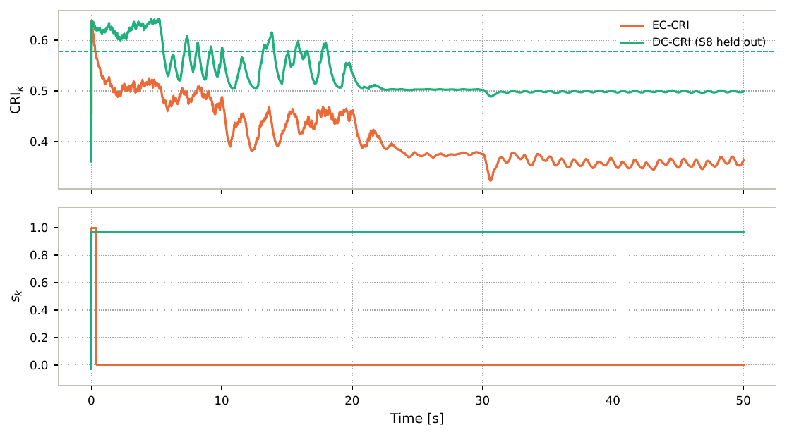

*The clearest single illustration of the generalization gap: on S8 held out from calibration,
EC-CRI's fixed threshold correctly rejects activation almost throughout (mean $`s_k=0.008`$), while
DC-CRI's calibrated threshold -- never having seen S8 -- remains active almost throughout (mean
$`s_k=1.000`$). A wrong readiness estimate transfers authority to the candidate controller; any
residual protection then depends on the fallback, which is itself not guaranteed to preserve the
admissible set in this scenario.*

**Modeling note.** The hard operational safe set behind $`z_k^{(H)}`$ is defined as voltage/current/
DC-link limits only (`dc_calibration.hard_limit_violation`), not the broader authority/noise/drift
mechanism label used for the EC protocol -- actuator setpoint-box headroom is excluded because
it is already captured inside SMI, not a physical-plant-safety violation in the same sense.

**Coupling-weight diagnostic.** `scripts/ci_weight_diagnostic.py` examines why the calibrated
coupling weight $`\omega_C^\star`$ is zero in all eight folds, using only the saved calibration data
(`results/dc_cri_calibration_trajectories.npz`) and the unmodified `dc_calibration` functions -- no
simulation. It reproduces the stored fold weights, confirms $`\omega_C^\star=0`$ with an exact
simplex-QP solution (KKT support enumeration), 20 random SLSQP starts and a strictly positive CI
reduced cost, and quantifies redundancy: an OLS regression of CI on the other four indicators gives
$`R^2=0.729`$, and a class-balanced logistic regression on the pooled calibration data
($`z_k^{(H)}`$, 8 scenarios × 5 seeds, in-sample) gives AUC $`0.9686`$ without CI vs. $`0.9687`$ with CI.
The recorded output is `results/ci_weight_diagnostic_output.txt`; reproduce it from the repository
root with `python scripts/ci_weight_diagnostic.py` (a few seconds).

Every number above is reproducible directly from `results/*.csv` via
`notebooks/13_dc_cri_loso.ipynb` and `notebooks/14_dc_cri_sensitivity.ipynb`.

## Comparison with Runtime Assurance and Control Barrier Functions

`notebooks/15_rta_cbf_benchmark.ipynb` compares CRI-supervised activation with two established
safety-supervision paradigms, under the same plant, candidate (OFO), fallback (droop), scenarios,
seeds, horizon, and operational limits:

* **Simplex RTA** (`baselines_rta_cbf.SimplexRTASupervisor`) -- a model-predictive recoverability
  monitor (25-step / 0.5 s look-ahead: candidate command for one step, fallback afterwards, checked
  against a tightened admissible set); switches to the fallback on the first failed check and
  returns authority after 100 consecutive passes.
* **Discrete-time CBF-QP filter** (`baselines_rta_cbf.DiscreteCBFFilter`) -- minimally modifies the
  candidate command so that DC-link energy, AC-voltage (one-step-shifted, high-order form), and
  current barriers satisfy $`h(x_{k+1})\ge(1-\gamma)h(x_k)`$, with a lexicographic feasibility
  relaxation when no admissible command exists. For CBF, a step counts as candidate authority only
  when the command passes unmodified.

**Information parity.** Both baselines see only what the CRI sees (measured outputs, applied
command, operational limits) **plus the nominal plant model** that the OFO candidate already
embeds; unmeasured disturbances are handled by lumped-disturbance estimates. They never see the
hidden truth. Their guarantees therefore hold only for the nominal model. RTA/CBF settings were
selected on separate development trials (randomized scenario generator, seeds 1000-1004) disjoint
from S1-S8, and DC-CRI uses its stored per-fold LOSO parameters -- no information leaks from the
evaluation scenarios.

**LOSO protocol** ($`z_k^{(H)}`$, $`T_H=0.5`$ s; equal-weight mean over the eight held-out scenarios;
source: `results/r1c7_protocolB_aggregate.csv`):

| Method | $`N_{FA}^{(H)}`$ | FAR | FDR | $`A_c`$ | True violation samples | Integrated exceedance [pu·s] |
|---|---|---|---|---|---|---|
| Direct activation | 794.9 | 0.500 | 0.000 | 1.000 | 694.7 | 2.944 |
| Hard-limit supervisor | 222.1 | 0.142 | 0.022 | 0.756 | 520.9 | 1.320 |
| EC-CRI | 6.1 | 0.033 | 0.247 | 0.683 | 323.9 | 1.303 |
| DC-CRI | 374.3 | 0.217 | 0.054 | 0.806 | 518.0 | 1.449 |
| Simplex RTA | 7.9 | 0.020 | 0.397 | 0.474 | 537.7 | 1.360 |
| DT-CBF filter | 80.1 | 0.264 | 0.139 | 0.748 | 282.6 | 1.565 |
| Fallback only (reference) | 0.0 | 0.000 | 1.000 | 0.000 | 445.1 | 1.360 |

What the benchmark supports:

* **No method dominates.** Simplex RTA has the lowest FAR (0.020) but the lowest availability
  (0.474); EC-CRI combines a low FAR (0.033) with higher availability (0.683); the CBF filter has the
  fewest true hard-limit violation samples (282.6) but the highest FAR (0.264) and the largest
  integrated exceedance; DC-CRI has the highest availability of the supervised methods (0.806).
  Under the EC protocol ($`z_k^{\mathrm{unsafe}}`$, seed 1) the mean false-activation count is 66.5
  for EC-CRI, 32.0 for RTA and 248.4 for CBF, at availabilities 0.684, 0.461 and 0.749.
* **Baseline results depend on their tuning.** With the a-priori CBF decay rate $`\gamma=0.2`$
  instead of the development-set choice $`\gamma=1`$, the CBF filter reaches FAR 0.009 at
  availability 0.677 -- lower FAR than EC-CRI at comparable availability
  (`results/r1c7_sensitivity_protocolB_aggregate.csv`). The ranking is therefore
  setting dependent.
* **Many violations are not caused by the supervisor.** In S7 every method, including the fallback
  alone, produces the same 1100 violation samples, and in S8 the fallback alone produces about
  1483 -- the fallback itself does not keep the plant admissible in these scenarios.
* Ten validation checks pass, including bit-identical reproduction of the stored Direct,
  Hard-limit, EC-CRI and DC-CRI results by the benchmark runner
  (`results/r1c7_validation_checks.csv`).

## Measurement Validity Gate

The CRI indicators assume that every delivered sample is a genuine, current measurement. The
**Measurement Validity Gate (MVG)** (`cri_microgrid/mvg.py`, closed loop in `mvg_sim.py`) is an
optional layer in front of the unchanged `CRISupervisor` that checks each delivered sample:

| Check | Rule (defaults) | Rejects |
|---|---|---|
| Finite | all 7 measured channels finite | NaN/Inf, dropped packets |
| Fresh | packet age $`\le 0.03`$ s and strictly increasing timestamp (when timestamps exist) | stale, repeated, delayed packets |
| Plausible | wide sensor-range envelope (e.g. voltages in $`[0.3,1.7]`$ pu) | gross outliers only |
| Not frozen | no channel repeats exactly for 10 samples while an input that physically drives it is changing; exactly-zero currents are exempt | stuck-at (non-zero) channels |

On an invalid sample the CRI is not updated, the candidate is deactivated ($`s_k=0`$) and its
internal update frozen, the digital-twin/operator flag is raised, and the fallback receives, channel
by channel, the current value if it is usable and otherwise that channel's last usable value. On
recovery the CRI state is reset, and authority returns only after
$`R=\max(N,2N_a)=40`$ consecutive valid samples, so every CRI data window contains post-fault data
only.

**The MVG is distinct from the Noise-Confidence Index.** NCI is one of the five readiness
indicators and grades the trustworthiness of the *estimated sensitivity* under noise; the MVG is a
binary validity decision on each *delivered sample* and does not modify NCI or any other indicator.

Results (`notebooks/16_measurement_validity_gate.ipynb`, files `results/r1c8_*.csv`):

* **No effect in fault-free operation.** In 62 fault-free runs (EC-CRI 46, DC-CRI 16) the gated
  closed loop is bit-identical to the reference implementation on every logged field, and the gate
  never triggers.
* **Detected faults.** Non-finite values/dropouts, stale packets (with timestamps), a persistent
  3-sample delay, and a gross outlier are detected on the first faulty sample; a frozen channel and
  stale data without timestamps after 0.18 s. Without the gate, a single NaN or a dropout stops the
  simulation in the sensitivity estimator; with the gate every fault case runs to completion and no
  non-finite value reaches the CRI.
* **Not detected (by design).** A stuck-at-zero current sensor (zero currents are legitimately
  constant on a de-energized feeder) and moderate outliers inside the plausibility envelope (+0.2 pu).
* **The fallback transition is not a safety guarantee.** During 0.5 s dropout or stale-data faults
  the fallback, running on held data, produces 12 hard-limit violation samples (without the gate,
  stale data leave the candidate running with no violations, and a dropout stops the simulation).
* **Recovery.** With $`R=40`$, authority returns 0.78 s after a fault ends.

The gate is not a sensor-fault diagnosis/isolation scheme and does not detect every possible
sensor fault.

## EC-CRI Weight Sensitivity

`scripts/ec_cri_weight_sensitivity.py` perturbs each EC-CRI weight one at a time by ±20% (with
renormalization to unit sum) and also tests equal weights, over S1-S8 with the setup of notebook 09
and the EC protocol (files `results/r1c5_weight_sensitivity_*.csv`). Across the ten single-weight
perturbations, the mean false-activation count stays between 57.9 and 81.8 (nominal 66.5, equal
weights 79.3), and the mean availability stays at 0.68-0.69 except for $`\omega_R\times0.8`$ and
$`\omega_N\times1.2`$, where it drops to about 0.59 because the hazard-free scenarios lose
availability (about 0.81 instead of 0.999).

## Repository Structure

```
CRI/                                # Repository root
├── README.md
├── LICENSE.txt
├── requirements.txt
├── .zenodo.json                   # Archival metadata for Zenodo releases
├── cri_microgrid/                 # Core simulation, controller, and CRI package
│   ├── config.py                  #   PlantParams, ControllerParams, ConstraintParams, ProbeParams,
│   │                              #   ProfileParams, NoiseParams, ScenarioParams, CRIParams, SimulationParams
│   ├── plant.py                   #   HybridACDCPlant: two-VSC hybrid AC/DC plant; CRI-blind by construction
│   ├── controllers.py             #   FallbackDroopController (u_safe), OFOVSCController (candidate), blend_command
│   ├── sensitivity.py             #   estimate_sensitivity: weighted regularized local S_hat
│   ├── probing.py                 #   Safe micro-probing, SMI-scaled amplitude, actuator-bound clipping
│   ├── cri.py                     #   The five indicators, CRI combination/filter/classification, CRISupervisor
│   ├── dc_calibration.py          #   DC-CRI weight/threshold calibration, LOSO orchestration
│   ├── baselines_rta_cbf.py       #   Nominal-model predictor, Simplex RTA supervisor, discrete-time CBF-QP filter
│   ├── benchmark_sim.py           #   Closed-loop runner with a pluggable supervisor (RTA/CBF benchmark)
│   ├── benchmark_eval.py          #   Scenario builders, EC and LOSO evaluation protocols for the benchmark
│   ├── mvg.py                     #   Measurement Validity Gate (finite/fresh/plausible/not-frozen, recovery)
│   ├── mvg_sim.py                 #   CRI closed loop with the gate and measurement-fault injection
│   ├── interfaces.py              #   Protocols for bringing your own controller/plant (see notebook 12)
│   ├── profiles.py                #   Load/PV/drift exogenous-input building blocks
│   ├── scenarios.py               #   S1-S8 scenario builders + S10 randomized-trial builder
│   ├── sim.py                     #   run_closed_loop / run_closed_loop_generic: master closed-loop simulation
│   ├── metrics.py                 #   Readiness/activation and control/disturbance metrics (+ FAR/FDR/A_c, DC-CRI)
│   ├── timing.py                  #   Isolated CRI-update execution-time benchmarking
│   ├── validation.py              #   Simulation-only ground truth (z_k^unsafe), confusion-matrix counts
│   └── plotstyle.py               #   Shared figure formatting and color system
├── notebooks/                     # One notebook per study; each only CALLS cri_microgrid functions
│   ├── 01_nominal_readiness.ipynb  ...  10_statistics_and_complexity.ipynb
│   ├── 11_Implementation_Time.ipynb      # Isolated, real-data CRI-update timing
│   ├── 12_bring_your_own.ipynb           # Template for a new controller, plant, or hardware target
│   ├── 13_dc_cri_loso.ipynb              # DC-CRI calibration + 8-fold LOSO evaluation
│   ├── 14_dc_cri_sensitivity.ipynb       # Risk/horizon sensitivity + LOSO summary and trajectory figures
│   ├── 15_rta_cbf_benchmark.ipynb        # Comparison with Simplex RTA and a CBF safety filter
│   └── 16_measurement_validity_gate.ipynb  # Measurement validity, fault-injection and recovery tests
├── scripts/
│   ├── ec_cri_weight_sensitivity.py      # One-at-a-time EC-CRI weight-sensitivity study
│   └── ci_weight_diagnostic.py           # Read-only diagnostics of the zero DC-CRI coupling weight
├── Figures/                       # Figures (PDF): notebook outputs and the framework diagrams
├── README_Figures/                # PNG renders used in this README
└── results/                       # CSV/JSON/LaTeX exports of every study's numerical results
```

**Results naming.** `results_S*.csv` and `results_strategy_*` hold the EC-CRI scenario studies
(notebooks 01-08); `results_dc_cri_*` the DC-CRI/LOSO studies (13-14); `r1c7_*` the
benchmark (15; `_protocolA_*` = EC protocol with $`z_k^{\mathrm{unsafe}}`$, `_protocolB_*` = LOSO
protocol with $`z_k^{(H)}`$, `_table_*.tex` = LaTeX tables generated from the CSVs, `_run_metadata.json`
= versions, seeds and settings); `r1c8_*` the Measurement Validity Gate (16); and
`r1c5_weight_sensitivity_*` the weight study; `ci_weight_diagnostic_output.txt` is the recorded
output of the coupling-weight diagnostic. The vector framework diagrams are
`Figures/problem_formulation.pdf`, `Figures/framework_architecture.pdf`, and
`Figures/loso_framework.pdf`.

## Installation

Requires Python 3.10+.

```bash
git clone https://github.com/MustafaKamoona/CRI.git
cd CRI
pip install -r requirements.txt
```

No GPU, no external solver, no EMT toolchain, and no proprietary software are required --
everything runs on NumPy/SciPy/pandas in a discrete-time, fixed-step simulation loop. The recorded
results were produced with Python 3.10.9, NumPy 2.2.6, SciPy 1.15.3, pandas 2.3.3 and
matplotlib 3.10.3 (the versions pinned in `requirements.txt`).

## Quick Start

```python
from cri_microgrid.config import (PlantParams, ControllerParams, ConstraintParams,
                                   CRIParams, ProbeParams, ProfileParams, SimulationParams)
from cri_microgrid import scenarios, sim

pp, cp, cons, crip, probep, prof = (PlantParams(), ControllerParams(), ConstraintParams(),
                                     CRIParams(), ProbeParams(), ProfileParams())
scenario = scenarios.build_S1(pp, prof, T_end=40.0)

for strategy in ["direct", "threshold", "cri"]:
    simp = SimulationParams(T_end=scenario.T_end, seed=1, strategy=strategy)
    log = sim.run_closed_loop(scenario, pp, cp, cons, crip, probep, simp)
    print(strategy, "mean CRI:", log["CRI"].mean(), " active fraction:", log["s"].mean())
```

Or open any notebook in `notebooks/` and run it top to bottom -- each is self-contained
and exports its own figures (to `Figures/`) and results (to `results/`).

## Notebooks Guide

| # | Notebook | Scenario(s) | Key outputs |
|---|---|---|---|
| 01 | `nominal_readiness` | S1 | `results_S1.csv`, `Fig_CRIDashboard.pdf`, `Fig_nominal_pu.pdf` |
| 02 | `constraint_limited` | S2 | `results_S2.csv`, `Fig_constraint_margin.pdf`, `Fig_probe_scaling.pdf` |
| 03 | `weak_authority` | S3 | `results_S3.csv`, `Fig_RI_authority.pdf` |
| 04 | `coupling_and_topology` | S4, S7 | `results_S4_S7.csv`, `Fig_Shat_heatmaps.pdf`, `Fig_topology_event.pdf` |
| 05 | `fast_drift` | S5 (normal/fast/very-fast) | `results_S5.csv`, `Fig_AI_drift.pdf` |
| 06 | `noise_confidence` | S6 (0-2% noise) | `results_S6.csv`, `Fig_NCI_noise.pdf`, `Fig_noise_surface.pdf` |
| 07 | `combined_severe` | S8 | `results_S8.csv`, `Fig_severe_dashboard.pdf` |
| 08 | `direct_vs_cri` | S1-S8, three-way comparison | `results_strategy_comparison.csv`, `results_scenario_fingerprint.csv`, `Fig_scenario_fingerprint.pdf` |
| 09 | `parameter_sensitivity` | $`N\times\eta_A`$, $`\lambda_s\times\delta_{\max}`$ sweeps + 3D surface + $`\pm20\%`$ threshold/weight robustness | `results_param_sweep.csv`, `results_threshold_weight_sensitivity.csv`, `Fig_parameter_heatmaps.pdf`, `Fig_readiness_surface_3d.pdf` |
| 10 | `statistics_and_complexity` | 30 randomized trials + timing sweep + 20-seed Monte Carlo over S1-S8 | `results_statistics.csv`, `results_complexity.csv`, `results_multiseed_monte_carlo.csv`, `Fig_statistics.pdf`, `Fig_complexity.pdf` |
| 11 | `Implementation_Time` | Isolated real-data timing of `CRISupervisor.step()` at case-study dimensions | `results_implementation_time_summary.csv`, `results_implementation_time_per_scenario.csv` |
| **12** | **`bring_your_own`** | Template: your controller, your plant, or a HIL/experimental target | Interface protocols, worked examples, and the HIL/experimental deployment guide -- see the [dedicated section](#extending-the-framework-bring-your-own-controller-plant-or-hardware) below |
| **13** | **`dc_cri_loso`** | DC-CRI weight/threshold calibration + 8-fold LOSO evaluation (S1-S8, each held out in turn) | `results_dc_cri_loso_folds.csv`, `results_dc_cri_loso_perscenario(_summary).csv`, `results_dc_cri_loso_aggregate.csv`, `results_dc_cri_calibration_diagnostics.csv`, `dc_cri_calibration_trajectories.npz` |
| **14** | **`dc_cri_sensitivity`** | Risk-tolerance sweep ($`\epsilon_{\mathrm{risk}}`$) and verification-horizon sweep ($`T_H`$), both under full LOSO re-evaluation | `results_dc_cri_risk_sensitivity.csv`, `results_dc_cri_horizon_sensitivity.csv`, `Fig_dc_cri_loso_summary_V2.pdf`, `Fig_dc_cri_representative_trajectory.pdf` |
| **15** | **`rta_cbf_benchmark`** | Direct / Hard-limit / EC-CRI / DC-CRI / Simplex RTA / CBF filter on S1-S8 under both evaluation protocols, development-set selection, validation checks, tuning sensitivity | `r1c7_*.csv`, `r1c7_table_*.tex`, `r1c7_run_metadata.json` -- see the [benchmark section](#comparison-with-runtime-assurance-and-control-barrier-functions) |
| **16** | **`measurement_validity_gate`** | Fault-free equivalence (62 runs), plausibility envelope, frozen-channel safeguards, 11 fault-injection cases, recovery length, cold-start variant | `r1c8_*.csv`, `r1c8_run_metadata.json` -- see the [gate section](#measurement-validity-gate) |

Every strategy comparison within a notebook uses the same random seed across all supervisory
strategies, so all of them see an identical disturbance/noise realization -- a fair, paired
comparison throughout.

## Reproducing the Results

1. Install the pinned environment (see [Installation](#installation)).
2. Run a notebook top to bottom from the `notebooks/` directory, e.g.

   ```bash
   cd notebooks
   jupyter nbconvert --to notebook --execute --inplace 13_dc_cri_loso.ipynb
   ```

   Notebooks write to `../results` and `../Figures` relative to their own location and overwrite
   their own output files.
3. Run the weight study from the repository root with
   `python scripts/ec_cri_weight_sensitivity.py`. It refuses to overwrite existing outputs, so
   delete the three `results/r1c5_weight_sensitivity_*.csv` files first.
4. Run the coupling-weight diagnostic with `python scripts/ci_weight_diagnostic.py`. It only reads
   saved files and prints to the console; compare with `results/ci_weight_diagnostic_output.txt`.

**Dependencies between studies.** Notebooks 15 and 16 read `results/results_strategy_comparison.csv`
(notebook 08) and `results/results_dc_cri_loso_folds.csv` / `results_dc_cri_loso_perscenario.csv`
(notebook 13) and verify that they reproduce them exactly before running anything new. Notebook 15
takes about 10 minutes and notebook 16 about 5-6 minutes on a desktop CPU.

**Determinism.** All simulations use fixed seeds, so results are deterministic for a given
environment; the stored outputs were produced with the pinned versions listed above. Execution-time
columns (e.g. `sup_time_*_ms`, implementation-time results) are machine dependent.

## CRI Design Parameters

Parameter roles:

| Parameter | Role | Typical Effect of Increasing It | Practical Interpretation |
|---|---|---|---|
| $`N`$ | Moving-window length | Smoother but slower readiness estimation | Amount of recent data used by the CRI layer |
| $`\lambda_s`$ | Sensitivity regularization | More robust but less sensitive estimate | Protection against ill-conditioned probing data |
| $`\bar\delta_{\max}`$ | Maximum probing amplitude | More informative but potentially more intrusive probing | Maximum allowed online excitation |
| $`r_0`$ | Responsiveness normalization | Larger value makes RI more conservative | Required local input-output authority |
| $`a_0`$ | Adaptability normalization | Larger value tolerates faster drift | Maximum acceptable operating-point variation |
| $`\sigma_{y,0}^2`$ | Noise normalization | Larger value tolerates noisier measurements | Maximum acceptable measurement-noise level |
| $`\eta_A,\eta_M,\eta_D`$ | Decision thresholds | Higher values make activation more conservative | Activation, monitoring, and delay boundaries |
| $`\omega_i`$ | CRI weights | Prioritizes selected readiness components | Application-dependent importance factors |

And the exact numeric defaults, straight from `cri_microgrid/config.py::CRIParams` -- what
produced every EC-CRI result in this repository:

| Parameter | Symbol | Value |
|---|---|---|
| Window length | `N` | 40 |
| Adaptability window | `Na` | 20 |
| Sensitivity regularization | `lambda_s` | 1e-3 |
| Responsiveness normalization | `r0` | 0.06 |
| Adaptability normalization | `a0` | 0.12 |
| Noise normalization | `sigma_y0_sq` | 3e-3 |
| Residual normalization | `epsilon_0s` | 0.50 |
| CRI weights | `omega_R,C,S,A,N` | 0.20, 0.10, 0.30, 0.15, 0.25 |
| Activate / Monitor / Delay thresholds | `eta_A, eta_M, eta_D` | 0.64, 0.565, 0.40 |
| DT-escalation thresholds | `eta_S, eta_N` | 0.30, 0.35 |
| Dynamic-filter bounds | `beta_min, beta_max` | 0.05, 0.50 |
| Beta-noise sensitivity | `kappa_beta` | 2.0 |
| Min adaptation scaling | `kappa_min` | 0.05 |
| Max probing amplitude | `delta_max` | 0.05 pu |

DC-CRI replaces the weights and thresholds per LOSO fold (stored in
`results/results_dc_cri_loso_folds.csv`); the principal calibration settings are
$`\epsilon_{\mathrm{risk}}=0.01`$, $`T_H=0.5`$ s ($`H=25`$ samples) and $`\lambda_H=2`$.

## Extending the Framework: Bring Your Own Controller, Plant, or Hardware

`notebooks/12_bring_your_own.ipynb` is a complete, standalone template for putting the
CRI engine to work beyond the reference microgrid case study -- for any development, design, or
engineering team building their own controller, plant model, or hardware deployment. It ships with
full worked examples, and this section summarizes its content end to end.

### Two levels of reuse

| You want to... | Use | What you provide |
|---|---|---|
| Test a *new candidate controller* (your optimizer/RL/MPC/PSO tuner) on the reference microgrid | `sim.run_closed_loop(..., candidate=your_controller)` | An object satisfying `CandidateControllerProtocol` |
| Test the CRI framework on an *entirely different plant* | `sim.run_closed_loop_generic(...)` | Objects satisfying `PlantProtocol`, `CandidateControllerProtocol`, `FallbackControllerProtocol`, plus a margin function |

### Interface contract

The three `typing.Protocol`s in `cri_microgrid/interfaces.py` are the entire integration surface;
nothing else in `cri_microgrid` needs to change.

| Protocol | Required methods | Used for |
|---|---|---|
| `CandidateControllerProtocol` | `candidate_command()`, `propose_nominal_step(y_meas)`, `shadow_update(delta_nominal, kappa_k)`, `reset(u0=None)` | Your optimizer, RL policy, PSO/HHO tuner, or neural adaptive controller |
| `FallbackControllerProtocol` | `command(y_meas)` | The conservative fallback controller used whenever $`s_k=0`$ |
| `PlantProtocol` | `measure(exo, noise_cfg=None)`, `step(u, t, exo, actuator_gain, topo, noise_cfg=None)` | Your simulated (or, for HIL, your interfaced real-time) system |

`interfaces.check_interfaces(candidate=..., fallback=..., plant=...)` validates any subset before a
run starts, raising a clear error naming exactly which method is missing.

### From simulation to hardware-in-the-loop and experimental validation

The same CRI engine -- unchanged -- carries forward through progressively more realistic execution
environments, so a team can move from a pure software study to a physical deployment without
rewriting the readiness layer at any stage:

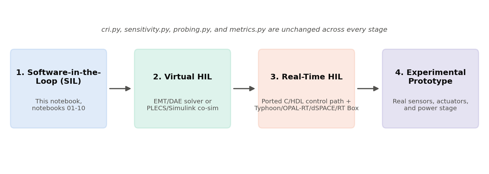

| Stage | What runs | What changes | What stays identical |
|---|---|---|---|
| **1. Software-in-the-loop (SIL)** | Everything in Python, as demonstrated in notebook 12 | Nothing -- this is the reference implementation | -- |
| **2. Virtual HIL** | A higher-fidelity plant model (EMT/DAE solver, PLECS/Simulink co-simulation, or a switched-converter model) | Only `PlantProtocol.measure()`/`step()` | `cri.py`, `sensitivity.py`, `probing.py`, `metrics.py`, and every notebook's analysis code |
| **3. Real-time HIL** | The control path ported to run within a fixed real-time step on a DSP/FPGA, exchanging I/O with a real-time-simulated power stage (Typhoon HIL, OPAL-RT, dSPACE, PLECS RT Box, Speedgoat) | Control-path functions re-implemented in C/HDL | The same five indicators, combination/filter/classification logic, and safe-probing law -- ported line-for-line |
| **4. Experimental prototype** | The ported controller driving a real (scaled or full-power) physical system | Sensors/ADC replace `noise_cfg`; actuator saturation is physical | The log schema, so `metrics.py` and every plotting routine work unchanged on hardware data |

On real hardware, measurement integrity (dropped, stale, or frozen samples) becomes a practical
concern; the [Measurement Validity Gate](#measurement-validity-gate) is the corresponding optional
layer in this repository.

**Real-time readiness, by construction.** Every step in the framework is a small,
self-contained, constant-time operation -- no history replay, no iterative solver, no dynamically
sized state. The dominant cost is the regularized sensitivity estimate, with complexity
$`\mathcal{O}(n_yn_uN+n_u^2N+n_u^3)`$; every other indicator and decision step is vector
arithmetic and threshold comparisons. Measured directly with real closed-loop data at the exact
case-study dimensions (`notebooks/11_Implementation_Time.ipynb`), one full `CRISupervisor.step()`
costs a mean of $`0.23`$ ms (maximum $`0.86`$ ms across all eight scenarios) against a $`20`$ ms
sampling interval -- see that notebook for the full breakdown, `notebooks/10_statistics_and_complexity.ipynb`
for the synthetic-data $`N`$/$`n_u`$ complexity sweep, and notebook 12's real-time porting checklist
for the concrete C/HDL porting steps (isolating `CRISupervisor.step()`, fixed- vs. floating-point
choices, WCET re-verification on the actual target, and re-deriving `D_u`, `D_y`, and the decision
thresholds for a differently scaled plant).

**Suggested validation sequence**, mapped to concrete CRI artifacts at every stage:

| Stage | What it validates | CRI-specific artifact to produce |
|---|---|---|
| 1. Software-in-the-loop (this repository) | The readiness logic itself, across all eight stress scenarios | `results/*.csv`, the eight scenario notebooks |
| 2. Processor-in-the-loop (PIL) | The ported C/HDL control path's numerical agreement with this Python reference | A per-sample diff of `RI, CI, SMI, AI, NCI, CRI, s, kappa` on an identical input trajectory |
| 3. Power-HIL | Real PWM, deadtime, and switching-level behavior | The same dashboard figures as notebooks 01-08, regenerated from HIL-logged data |
| 4. Scaled hardware prototype | The full eight-scenario test matrix on a reduced-power physical system | A Direct / Threshold / CRI three-way comparison on real hardware |
| 5. Field pilot | End-to-end operation with the safety fallback wired to a real fault/watchdog signal | Continuous logging of `s_k`, `kappa_k`, `cls_code`, `dt_flag` against the deployed system's own SCADA/event log |

**A hardware-compatible log schema.** `sim.run_closed_loop`'s log dictionary (`LOG_FIELDS` in
`sim.py`) is the schema every plotting routine and every function in `metrics.py` already expects.
Logging real hardware data under the same field names -- time and decision (`t, s, kappa, cls_code,
dt_flag`), indicators (`CRI, CRI_hat, RI, CI, SMI, AI, NCI, beta`), sensitivity diagnostics
(`epsilon_s, rho, condition_number, excitation_energy, sigma_hat_sq, a_raw`), probing (`probe_bar,
probe_norm`), plus your own measurement/command channels and `execution_time` -- means the exact
same analysis code runs unmodified on experimental data.

### Parameter re-tuning notes for a new plant

Two calibration properties carry over to any new deployment, documented directly in
`cri_microgrid/config.py` and demonstrated in notebook 12:

- **SMI has a structural ceiling** whenever it is a `min` of several headroom fractions that sum to
  a fixed budget -- calibrate `eta_A`/`eta_M`/`eta_D` against your own plant's achievable *nominal*
  CRI rather than against 1.0, the same way this study's thresholds were calibrated against its own
  ~0.7 nominal ceiling (or use the DC-CRI calibration in `dc_calibration.py`).
- **RI is a scalar aggregate.** On a multi-actuator plant, a healthy channel can mask a degraded one
  in the aggregate sensitivity energy alone -- NCI and SMI typically catch what RI alone misses (see
  scenario S3 in notebook 08 for a worked example on the reference microgrid).

## Supplementary Material

Beyond the main results above, the notebooks in this repository produce a complete set of
supplementary results:

| Material | Notebook | Description |
|---|---|---|
| Safe-probing scaling-law verification | 02 | Direct scatter-plot verification of $`\bar\delta_k=\bar\delta_{\max}\mathrm{SMI}_k`$ against the $`y=x`$ bound |
| All-scenario strategy comparison | 08 | Direct / Threshold / CRI compared across all eight scenarios in one figure |
| Scenario fingerprint | 08 | A heatmap summarizing every scenario's indicator profile side by side |
| Parameter-sensitivity heatmaps | 09 | $`N\times\eta_A`$ and $`\lambda_s\times\bar\delta_{\max}`$ design-tradeoff sweeps, plus a $`\pm20\%`$ threshold/weight robustness check |
| 3D readiness surface | 09 | CRI as a function of (SMI, NCI), holding RI/CI/AI fixed at representative values |
| Statistical validation | 10 | 30 randomized trials over load/parameter/noise conditions, plus a 20-seed Monte Carlo repeat of S1-S8 |
| Computational-complexity sweep | 10 | Measured timing vs. window length $`N`$ and input dimension $`n_u`$ |
| Implementation time | 11 | Isolated, real-data timing of one full `CRISupervisor.step()` on the actual case-study dimensions |
| Bring-your-own template | 12 | Full worked examples plus the HIL/experimental deployment guide above |
| One-at-a-time weight sensitivity | script | ±20% per-weight perturbations and equal weights (EC protocol) |

<p align="center">
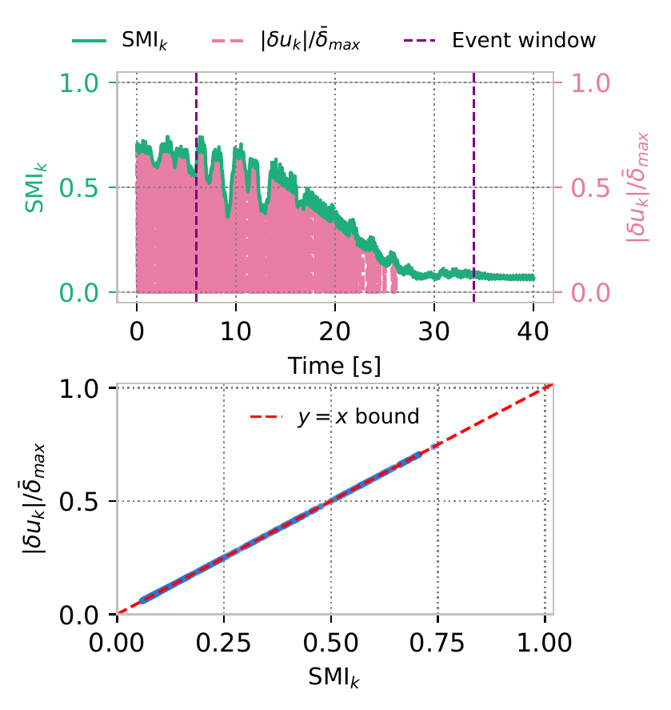
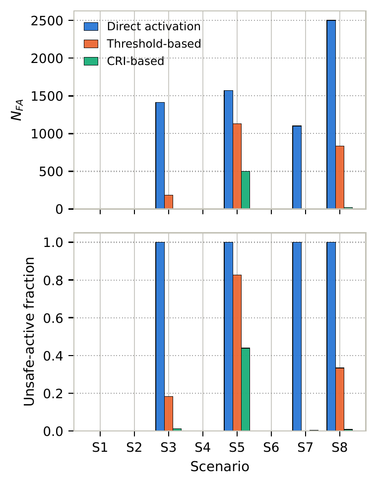
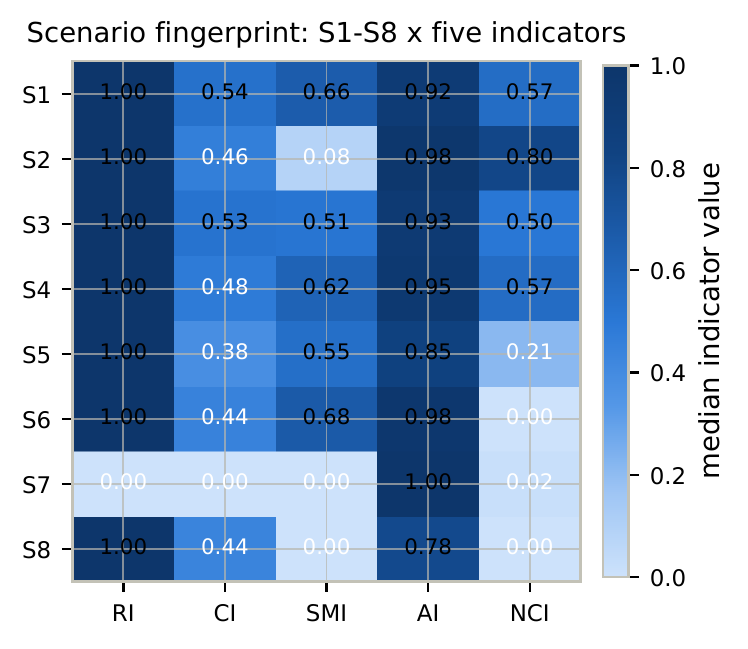
</p>
<p align="center">
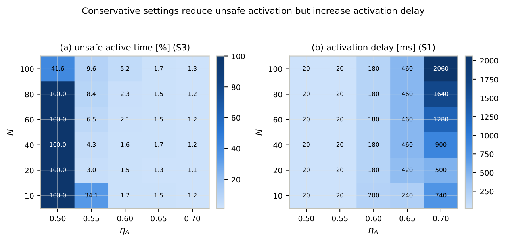
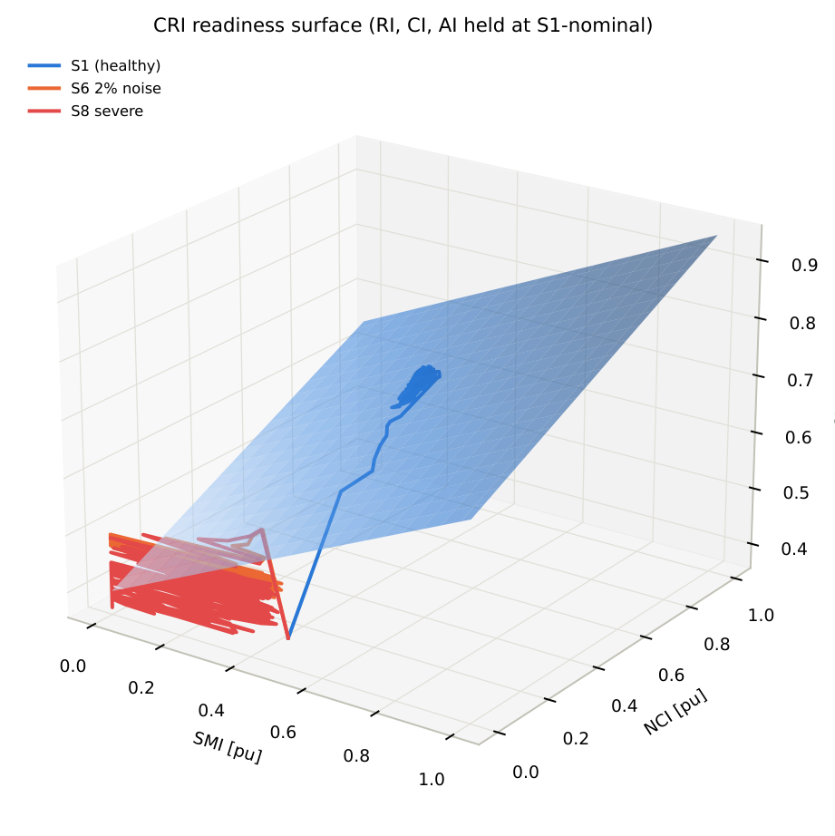
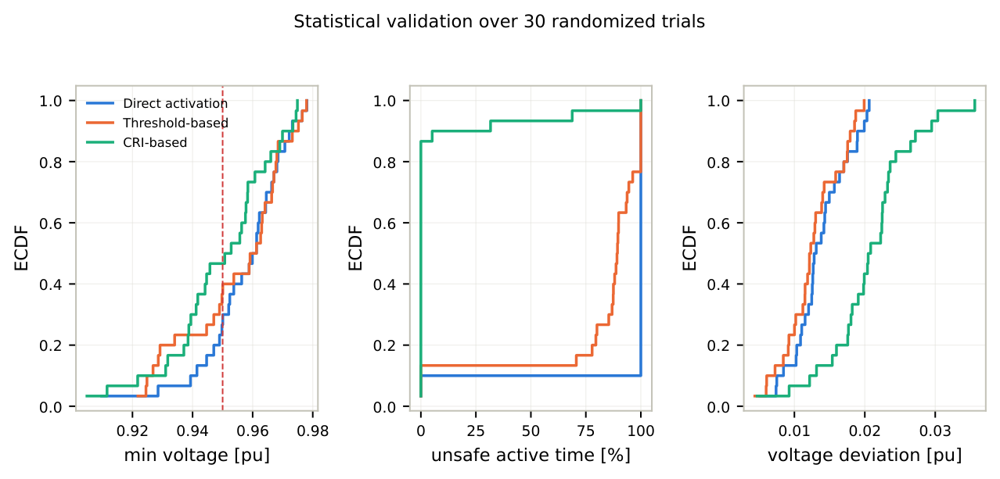
</p>

## Scope and Limitations

* **Simulation evidence.** All results come from a discrete-time, averaged-model simulation of one
  hybrid AC/DC microgrid; no hardware or EMT validation is included.
* **No formal safety guarantee.** The CRI is a readiness assessment, not a certificate. When it
  withholds authority, safety relies on the fallback controller, and in the most severe scenarios
  (S7, S8) the fallback itself does not keep the plant within its hard limits.
* **DC-CRI generalization** depends on the hazard mechanisms represented in the calibration pool;
  it degrades for under-represented, severe scenarios (S5, S8 held out).
* **Two evaluation labels.** EC-CRI headline numbers use the instantaneous mechanism-based label
  $`z_k^{\mathrm{unsafe}}`$; DC-CRI, LOSO and the benchmark's LOSO protocol use the finite-horizon
  hard-limit label $`z_k^{(H)}`$. Numbers from the two protocols are not directly comparable.
* **Baselines.** The RTA and CBF supervisors are reference implementations built on a shared
  nominal-model predictor; their results depend on their settings (see the benchmark section).
* **Measurement Validity Gate.** It detects the fault classes listed above, not all sensor faults,
  and requesting the fallback does not by itself guarantee safe operation.

## Citation and Archiving

Releases of this repository are archived on Zenodo; the DOI will be listed here once assigned.

> M. A. Kamoona, *CRI: Measurement-Driven Control Readiness Index (EC-CRI and DC-CRI)*, software,
> version v1.0.0, https://github.com/MustafaKamoona/Code-Data_CRI-EC_and_DC-

Data and code are also archived at IEEE DataPort, DOI: 10.21227/wv4k-z538.

## License

This repository is released under the [MIT License](LICENSE.txt).

## Acknowledgments

This work was supported by the Ministerio de Ciencia e Innovación (MCIN), Agencia Estatal de
Investigación (AEI), 10.13039/501100011033, through the European Regional Development Fund (ERDF),
"A way of making Europe," under Grant PID2021-124571OB-I00; by CDTI under Project Ad-Grhid
MIG-20221009, 127835OB-I00; and by the European Commission through the projects COCOON (COoperative
Cyber prOtectiON for modern power grids) under Grant 101120221 and SUNRISE under Grant 101079200.

## Contact

**Mustafa A. Kamoona** -- Department of Electrical Engineering, Universidad de Sevilla, Seville, Spain
Email: muskam@alum.us.es, mustafazzasim@gmail.com

**Prof. Juan Manuel Mauricio** -- Department of Electrical Engineering, Universidad de Sevilla, Seville, Spain
ORCID: [0000-0002-5702-0198](https://orcid.org/0000-0002-5702-0198)

For questions, issues, or collaboration inquiries, please open a GitHub issue on this repository.
